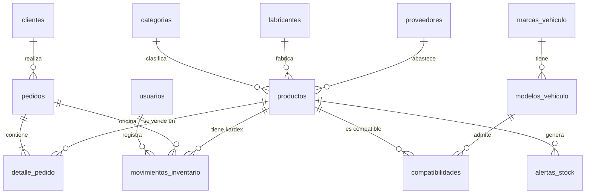

# Diccionario de datos — AutoPart Pro

**Motor:** MySQL 8.x (compatible con TiDB Cloud) · **Charset:** `utf8mb4` / `utf8mb4_unicode_ci` · **Motor de almacenamiento:** InnoDB
**Script:** [`database/schema.sql`](../database/schema.sql)

## Modelo entidad–relación

Convenciones: **PK** clave primaria, **FK** clave foránea, **UQ** único, **NN** no nulo, **AI** autoincremental.

---

## 1. `usuarios`
Usuarios internos que acceden al panel administrativo.

| Campo | Tipo | Restricciones | Descripción |
|---|---|---|---|
| id | INT UNSIGNED | PK, AI | Identificador del usuario |
| nombre | VARCHAR(100) | NN | Nombre completo |
| email | VARCHAR(150) | NN, UQ | Correo de acceso (login) |
| password_hash | VARCHAR(255) | NN | Contraseña cifrada con bcrypt (10 rondas) |
| rol | ENUM('admin','vendedor') | NN, def. 'vendedor' | `admin`: CRUD completo. `vendedor`: consulta y movimientos |
| activo | TINYINT(1) | NN, def. 1 | 1 = puede iniciar sesión |
| creado_en | DATETIME | NN, def. NOW | Fecha de registro |

## 2. `clientes`
Compradores de la tienda en línea (se registran al hacer checkout).

| Campo | Tipo | Restricciones | Descripción |
|---|---|---|---|
| id | INT UNSIGNED | PK, AI | Identificador del cliente |
| nombre | VARCHAR(120) | NN | Nombre o razón social |
| documento | VARCHAR(20) | NN, índice | Cédula o NIT |
| email | VARCHAR(150) | NN, índice | Correo para la factura |
| telefono | VARCHAR(20) | NN | Celular de contacto |
| direccion | VARCHAR(200) | NN | Dirección de envío |
| ciudad | VARCHAR(80) | NN | Ciudad de envío |
| creado_en | DATETIME | NN, def. NOW | Fecha de registro |

## 3. `categorias`
Sistemas del vehículo en que se agrupan los repuestos.

| Campo | Tipo | Restricciones | Descripción |
|---|---|---|---|
| id | SMALLINT UNSIGNED | PK, AI | Identificador |
| nombre | VARCHAR(80) | NN | Nombre visible (Frenos, Filtros…) |
| slug | VARCHAR(80) | NN, UQ | Identificador para URL (`frenos`) |
| descripcion | VARCHAR(255) | — | Texto descriptivo |

## 4. `fabricantes`
Marcas de los repuestos (Bosch, NGK, Brembo…).

| Campo | Tipo | Restricciones | Descripción |
|---|---|---|---|
| id | SMALLINT UNSIGNED | PK, AI | Identificador |
| nombre | VARCHAR(80) | NN, UQ | Nombre del fabricante |
| pais | VARCHAR(60) | — | País de origen |

## 5. `proveedores`
Empresas que abastecen la bodega.

| Campo | Tipo | Restricciones | Descripción |
|---|---|---|---|
| id | SMALLINT UNSIGNED | PK, AI | Identificador |
| nombre | VARCHAR(120) | NN | Razón social |
| nit | VARCHAR(20) | NN, UQ | NIT con dígito de verificación |
| telefono | VARCHAR(20) | — | Teléfono comercial |
| email | VARCHAR(150) | — | Correo de pedidos |
| ciudad | VARCHAR(80) | — | Ciudad |

## 6. `marcas_vehiculo`
| Campo | Tipo | Restricciones | Descripción |
|---|---|---|---|
| id | SMALLINT UNSIGNED | PK, AI | Identificador |
| nombre | VARCHAR(60) | NN, UQ | Marca del vehículo (Chevrolet, Mazda…) |

## 7. `modelos_vehiculo`
| Campo | Tipo | Restricciones | Descripción |
|---|---|---|---|
| id | SMALLINT UNSIGNED | PK, AI | Identificador |
| marca_id | SMALLINT UNSIGNED | NN, FK → marcas_vehiculo.id | Marca a la que pertenece |
| nombre | VARCHAR(60) | NN, UQ (marca_id, nombre) | Modelo (Spark GT, Mazda 3…) |

## 8. `productos`
Repuestos del inventario. **Tabla central del sistema.**

| Campo | Tipo | Restricciones | Descripción |
|---|---|---|---|
| id | INT UNSIGNED | PK, AI | Identificador |
| sku | VARCHAR(30) | NN, UQ | Código interno: `CAT-FAB-#####` |
| nombre | VARCHAR(150) | NN, índice | Nombre comercial (incluye vehículo de referencia) |
| descripcion | TEXT | — | Descripción técnica |
| categoria_id | SMALLINT UNSIGNED | NN, FK → categorias.id | Categoría |
| fabricante_id | SMALLINT UNSIGNED | NN, FK → fabricantes.id | Fabricante |
| proveedor_id | SMALLINT UNSIGNED | FK → proveedores.id (SET NULL) | Proveedor habitual |
| precio_costo | DECIMAL(12,2) | NN, def. 0 | Costo de compra (COP) |
| precio_venta | DECIMAL(12,2) | NN, CHECK ≥ 0 | Precio de venta con IVA incluido (COP) |
| stock | INT | NN, CHECK ≥ 0 | Unidades disponibles. **Solo cambia vía movimientos** |
| stock_minimo | INT | NN, def. 5 | Umbral que dispara la alerta |
| ubicacion | VARCHAR(30) | — | Ubicación en bodega `P(asillo)-E(stante)-N(ivel)` |
| imagen_url | VARCHAR(500) | — | Imagen opcional |
| activo | TINYINT(1) | NN, def. 1 | 0 = borrado lógico (no aparece en tienda) |
| creado_en | DATETIME | NN, def. NOW | Creación |
| actualizado_en | DATETIME | NN, ON UPDATE NOW | Última modificación |

Índices: `idx_productos_categoria`, `idx_productos_fabricante`, `idx_productos_stock (stock, stock_minimo)`, `idx_productos_nombre (nombre)`. La búsqueda por texto usa `LIKE` por cada palabra con la colación `utf8mb4_unicode_ci`, que no distingue mayúsculas ni tildes ("bujias" encuentra "bujías").

## 9. `compatibilidades`
Relación N:M entre productos y modelos de vehículo con rango de años. Es la base del **buscador por marca, modelo y año**.

| Campo | Tipo | Restricciones | Descripción |
|---|---|---|---|
| id | INT UNSIGNED | PK, AI | Identificador |
| producto_id | INT UNSIGNED | NN, FK → productos.id (CASCADE) | Repuesto |
| modelo_id | SMALLINT UNSIGNED | NN, FK → modelos_vehiculo.id | Modelo compatible |
| anio_desde | SMALLINT UNSIGNED | NN | Primer año compatible |
| anio_hasta | SMALLINT UNSIGNED | NN, CHECK ≥ anio_desde | Último año compatible |
| motor | VARCHAR(40) | — | Motorización (1.6L, 2.0L…) |

Índice compuesto `idx_compat_busqueda (modelo_id, anio_desde, anio_hasta)` para la consulta `? BETWEEN anio_desde AND anio_hasta`.

## 10. `movimientos_inventario` (Kardex)
Toda variación de stock queda registrada aquí.

| Campo | Tipo | Restricciones | Descripción |
|---|---|---|---|
| id | INT UNSIGNED | PK, AI | Identificador |
| producto_id | INT UNSIGNED | NN, FK → productos.id | Producto afectado |
| usuario_id | INT UNSIGNED | FK → usuarios.id (SET NULL) | Quién lo registró (NULL si fue automático por venta) |
| pedido_id | INT UNSIGNED | FK → pedidos.id (SET NULL) | Pedido que originó la venta |
| tipo | ENUM('entrada','salida','ajuste','venta') | NN | Naturaleza del movimiento |
| cantidad | INT | NN | Variación con signo (+ entra, − sale) |
| stock_anterior | INT | NN | Saldo antes |
| stock_resultante | INT | NN | Saldo después |
| motivo | VARCHAR(255) | — | Justificación (factura, conteo físico…) |
| creado_en | DATETIME | NN, def. NOW | Fecha y hora |

## 11. `pedidos`
| Campo | Tipo | Restricciones | Descripción |
|---|---|---|---|
| id | INT UNSIGNED | PK, AI | Identificador |
| referencia | VARCHAR(40) | NN, UQ | Referencia única enviada a Wompi (`AP-XXXX-XXXXX`) |
| cliente_id | INT UNSIGNED | NN, FK → clientes.id | Comprador |
| subtotal | DECIMAL(12,2) | NN | Base sin IVA |
| iva | DECIMAL(12,2) | NN | IVA 19 % |
| total | DECIMAL(12,2) | NN | Total cobrado |
| estado | ENUM('pendiente','pagado','rechazado','anulado','error') | NN, def. 'pendiente' | Estado según Wompi |
| metodo_pago | VARCHAR(30) | — | CARD, NEQUI, PSE, BANCOLOMBIA_TRANSFER… |
| wompi_transaction_id | VARCHAR(60) | — | Id de la transacción en Wompi |
| creado_en | DATETIME | NN, def. NOW | Creación |
| pagado_en | DATETIME | — | Fecha de aprobación |

## 12. `detalle_pedido`
| Campo | Tipo | Restricciones | Descripción |
|---|---|---|---|
| id | INT UNSIGNED | PK, AI | Identificador |
| pedido_id | INT UNSIGNED | NN, FK → pedidos.id (CASCADE) | Pedido |
| producto_id | INT UNSIGNED | NN, FK → productos.id | Producto |
| cantidad | INT UNSIGNED | NN, CHECK > 0 | Unidades |
| precio_unitario | DECIMAL(12,2) | NN | Precio congelado al momento de la compra |
| subtotal | DECIMAL(12,2) | NN | cantidad × precio_unitario |

## 13. `alertas_stock`
Alertas de stock mínimo. Se crean, actualizan y cierran automáticamente desde `InventarioModel.evaluarAlerta()`.

| Campo | Tipo | Restricciones | Descripción |
|---|---|---|---|
| id | INT UNSIGNED | PK, AI | Identificador |
| producto_id | INT UNSIGNED | NN, FK → productos.id | Producto en alerta |
| stock_actual | INT | NN | Stock al generar/actualizar la alerta |
| stock_minimo | INT | NN | Umbral vigente |
| nivel | ENUM('bajo','agotado') | NN | `agotado` si stock = 0 |
| estado | ENUM('activa','atendida') | NN, def. 'activa' | Se marca atendida al reponer stock por encima del mínimo |
| creado_en | DATETIME | NN, def. NOW | Fecha de la alerta |
| atendida_en | DATETIME | — | Fecha de cierre |

## Vistas

| Vista | Propósito |
|---|---|
| `vw_productos_catalogo` | Productos con nombre de categoría y fabricante (consulta de catálogo) |
| `vw_alertas_stock` | Productos activos con `stock ≤ stock_minimo`, nivel y cantidad sugerida a reponer (`stock_minimo × 2 − stock`) |

## Reglas de negocio implementadas

1. El stock nunca se edita directamente: entradas, salidas, ajustes y ventas pasan por `movimientos_inventario` dentro de una transacción con `SELECT … FOR UPDATE`.
2. El precio de cada línea se toma de la base de datos al crear el pedido; el navegador solo envía `producto_id` y `cantidad`.
3. El inventario se descuenta **solo cuando Wompi aprueba** el pago (estado `APPROVED`) y la operación es idempotente.
4. Si el monto reportado por Wompi no coincide con el total del pedido, el pedido pasa a `error`.
5. Los productos se eliminan de forma lógica (`activo = 0`) para conservar el histórico de ventas.
