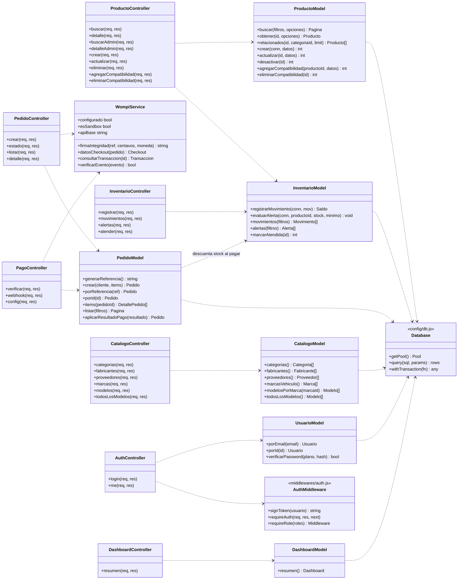
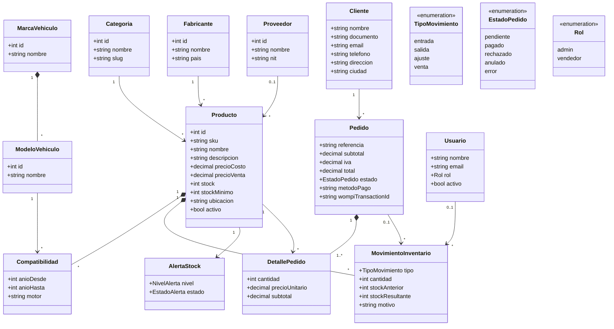
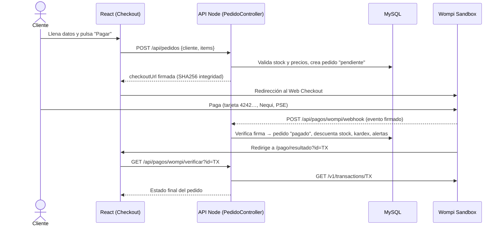

# Diagrama de clases — AutoPart Pro

La API sigue el patrón **MVC (Modelo–Vista–Controlador)**:

- **Modelo** (`server/models`): clases con métodos estáticos que encapsulan el SQL y las reglas de negocio.
- **Controlador** (`server/controllers`): recibe la petición HTTP, valida, invoca modelos/servicios y responde JSON.
- **Vista**: la SPA en React (`src/`) que consume la API REST.
- **Rutas** (`server/routes/index.js`) conectan URL → middleware → controlador.

## Diagrama general

## Entidades del dominio

## Flujo de compra con Wompi (secuencia)

## Componentes del frontend (Vista)

| Capa | Archivos | Responsabilidad |
|---|---|---|
| Contextos | `CartContext`, `AuthContext`, `VehicleContext` | Estado global: carrito, sesión JWT, "Mi vehículo" |
| Tienda | `Home`, `Catalogo`, `Producto`, `Checkout`, `PagoResultado` | Búsqueda filtrada y compra |
| Panel | `Dashboard`, `Inventario`, `ProductoAdmin`, `Alertas`, `Movimientos`, `Pedidos` | Gestión de inventario y ventas |
| Componentes | `VehicleSelector`, `ProductCard`, `StoreLayout`, `ui.tsx` | Piezas reutilizables |
| Librería | `lib/api.ts`, `lib/format.ts`, `lib/useFetch.ts` | Cliente HTTP, formato COP, carga de datos |
